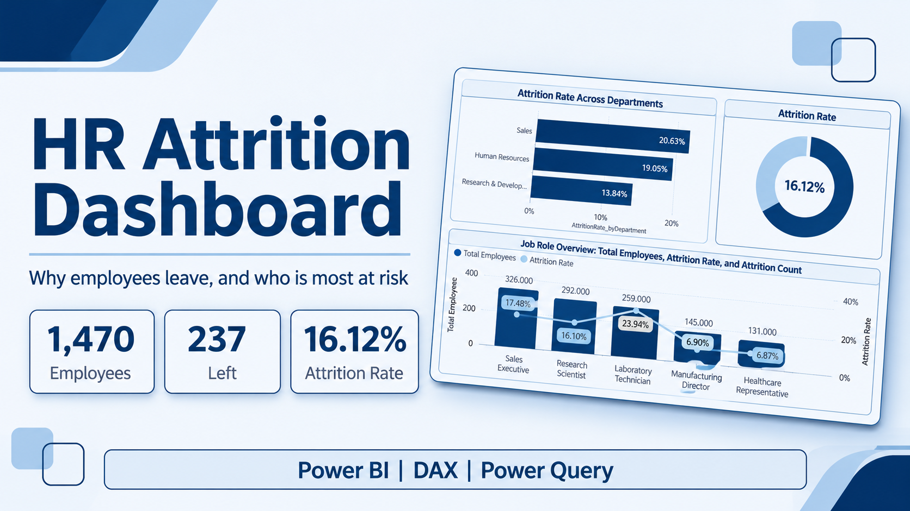
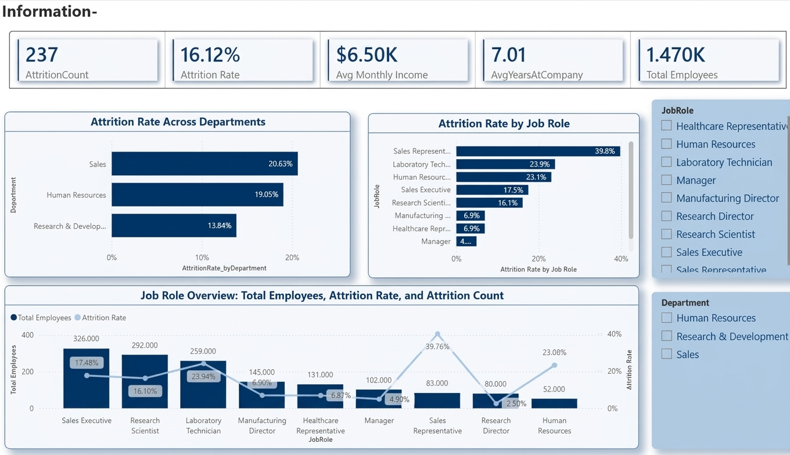
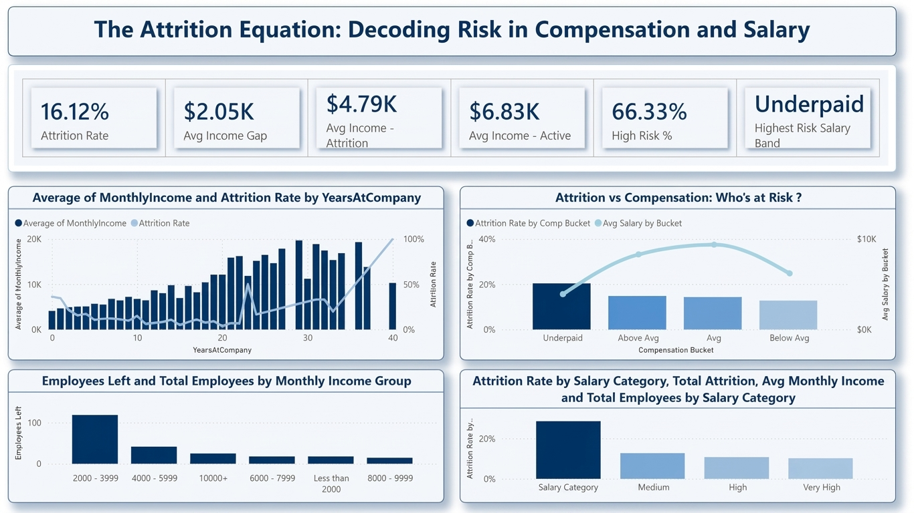
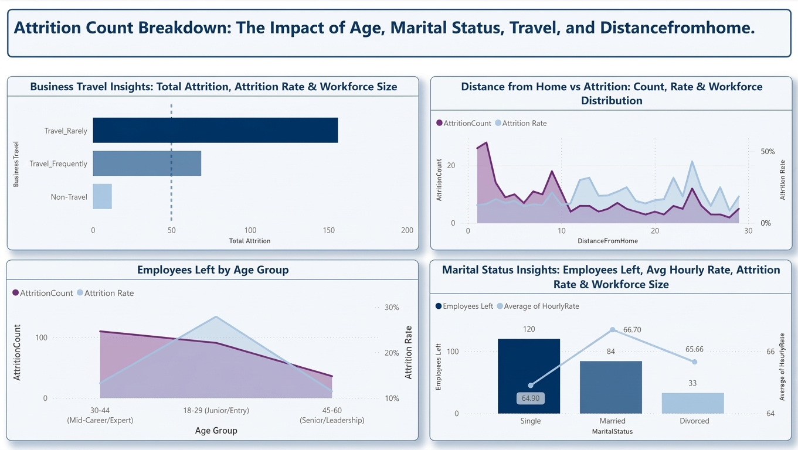
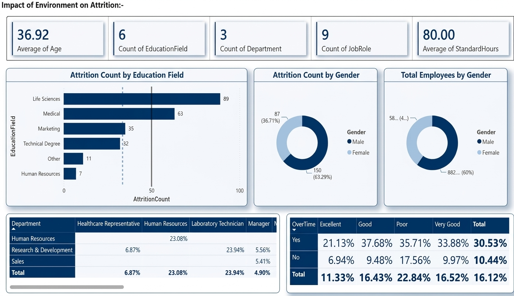
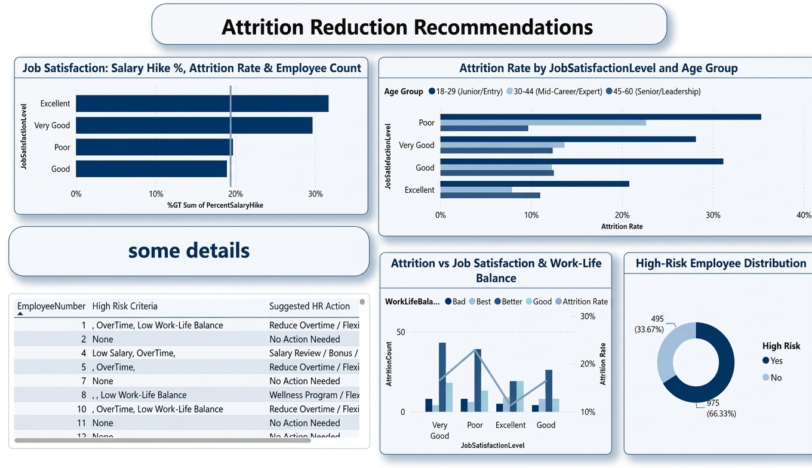
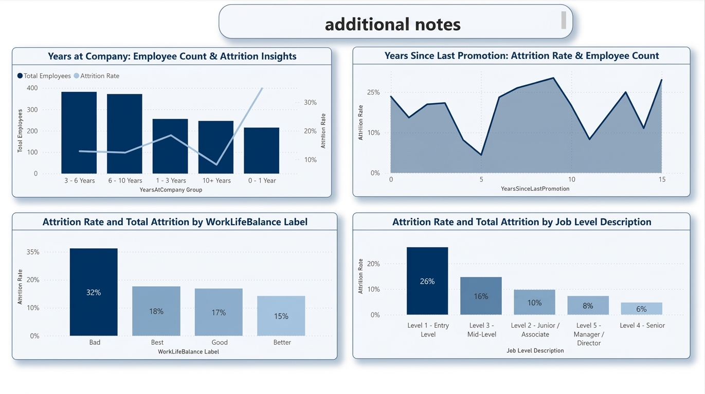
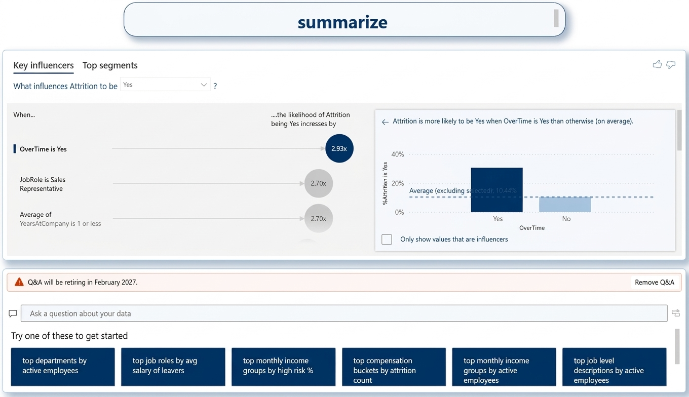

# HR Attrition Dashboard | Power BI

  <b>Turning HR Data into Actionable Workforce Insights</b>

---

## 📌 Project Overview

Why do employees leave their jobs?

The HR Attrition Dashboard is an interactive Business Intelligence project built using Microsoft Power BI to analyze employee turnover, identify the key factors influencing attrition, and highlight employee groups with higher attrition rates.

The project analyzes **1,470 employee records**, including **237 employees who left the company**, resulting in an overall attrition rate of **16.12%**.

The main objective is to transform raw HR data into meaningful insights that support better workforce management and employee retention decisions.

## 🎯 Business Objectives

This project aims to answer several important HR business questions:

* What are the main factors associated with employee attrition?
* How does overtime affect employee turnover?
* Is there a relationship between monthly income and attrition?
* Which job roles and employee groups have the highest attrition rates?
* How do work-life balance and job satisfaction relate to employee turnover?
* Which employee groups should HR prioritize in retention strategies?

## 📊 Key Insights

The analysis revealed several important findings:

| Factor            | Key Finding                                                                    |
| ----------------- | ------------------------------------------------------------------------------ |
| Overtime          | 30.5% attrition rate among employees working overtime vs. 10.4% among others   |
| Monthly Income    | Employees who left earned an average of $4.79K vs. $6.83K for active employees |
| Income Gap        | An average income difference of approximately $2.05K                           |
| Work-Life Balance | Attrition reached 32% among employees with poor work-life balance              |
| Job Level         | Approximately 26% attrition at entry level vs. 6% at senior level              |
| Job Role          | Sales Representatives recorded the highest attrition rate at 39.8%             |

These findings highlight potential retention challenges related to workload, compensation, career development, and employee well-being.

## 📑 Dashboard Structure

The dashboard consists of seven interactive pages:

### 1. Overview

* Main HR KPIs and workforce statistics.
* Overall employee attrition rate.
* Attrition by department and job role.
* Interactive filters for exploring employee data.

### 2. Compensation Analysis

* Average monthly income comparison.
* Income gap between active employees and leavers.
* Attrition by salary ranges and income groups.

### 3. Attrition Analysis

* Attrition by age groups.
* Marital status analysis.
* Business travel impact.
* Distance from home analysis.

### 4. Work Environment

* Attrition by education field.
* Gender-based analysis.
* Overtime impact.
* Job satisfaction analysis.

### 5. Recommendations

* Identification of employee groups with higher attrition risk.
* Employee risk classification.
* Suggested HR actions based on risk factors.
* Practical retention recommendations.

### 6. Additional Analysis

* Years at the company.
* Time since last promotion.
* Work-life balance.
* Job level analysis.

### 7. Key Influencers & Q&A

* Key Influencers visual to explore factors associated with attrition.
* Q&A visual for interactive data exploration.

## 🖼️ Dashboard Preview

### Overview

### Compensation Analysis

### Attrition Analysis

### Work Environment

### Recommendations

### Additional Analysis

### Key Influencers & Q&A

## ⚙️ Data Preparation & Analysis

The project involved the following stages:

**1. Data Preparation**

* Data cleaning and transformation using Power Query.
* Reviewing column data types and data quality.
* Preparing the dataset for analysis.

**2. Data Modeling**

* Building the Power BI data model.
* Organizing the analytical structure.

**3. DAX Development**

* Employee Count.
* Attrition Count.
* Attrition Rate.
* Average Monthly Income.
* Income Gap.
* Employee Risk Classification.

**4. Dashboard
